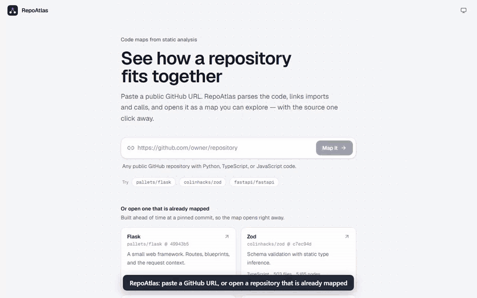
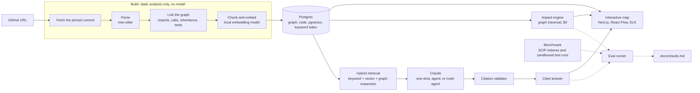

# RepoAtlas



**Paste a public GitHub URL, get an interactive map of the code, answers that cite file and
line, and a prediction of what breaks if you change a function. How accurate it is gets
measured and published, losses included.**

> **Status (2026-11-16): built, not yet launched.** All 18 milestones are built and tested.
> RepoAtlas has not been deployed anywhere and has no public URL yet; you can
> [run it yourself](#run-it-yourself) today. The recording above was made on a local stack
> and shows only features that use no model. Checks that need a live model or hosting are
> listed as pending in the [live pass](docs/live-pass.md), and nothing pending is reported
> here as done.

## What it does

- **A map you can explore.** Folders open into files, files into classes and functions.
  Edges are imports, calls, inheritance, and test links. Links the analysis resolved are
  solid; name-matched guesses are dashed and carry a confidence.
- **Answers with citations.** Every claim cites file and line ranges. A validator checks each
  citation against the stored code and drops the ones that don't hold; weak evidence gets a
  refusal, not a guess.
- **"What breaks if I change this?"** A ranked list of affected callers, subclasses, and
  tests, with the path that connects each one. It is a graph traversal, so it is
  deterministic and costs nothing.
- **Three ways to answer:** one retrieval and one model call (one-shot); a model that explores
  the graph with tools (agent); and a plan, parallel explorers, a writer, and a verifier
  (multi-agent). Only the first has measured results so far.
- **A gallery of ten well-known repositories**, built ahead of time at pinned commits, so a
  map opens without waiting: Flask, Zod, Requests, Zustand, Click, HTTPX, Remeda, Starlette,
  ts-pattern, and ItsDangerous ([`launch/repos.yaml`](launch/repos.yaml)).
- **Tools for coding agents.** The same graph queries are served over
  [MCP](docs/mcp.md).

Python, TypeScript, and JavaScript repositories are supported.

## How it works



Three rules hold the design together:

1. **Code builds the graph.** Static analysis creates every node and edge. The model never
   writes structure.
2. **Every claim is checkable.** Answers cite evidence, and citations are validated against
   the exact commit.
3. **Repository content is untrusted.** Text from a repo is data, never instructions; it is
   never rendered as HTML; and repo code runs only in a locked-down sandbox, and only for the
   benchmark's repositories.

One Postgres database holds everything (graph, code, vectors, jobs, traces). Embeddings run
locally on CPU. Details: [product requirements](docs/PRD.md) and the
[decision records](docs/decisions/README.md).

## Results

Measured on 2026-11-12 and 2026-11-13 on the frozen test split of the project's benchmark: 90
questions over five open-source repositories, three runs each, scored against ground truth
from SCIP indexes and sandboxed test runs, with 95% bootstrap intervals. Full tables, method,
and biases: **[docs/results.md](docs/results.md)**.

| | Score [95% CI] | Cost per question |
|---|---|---|
| No evidence (closed book) | 0.220 [0.150, 0.296] | $0.0036 |
| Keyword search | 0.441 [0.356, 0.528] | $0.0197 |
| Vector search | 0.522 [0.439, 0.608] | $0.0162 |
| **Hybrid search with the code graph** (the one-shot mode) | **0.570 [0.492, 0.648]** | $0.0220 |

- **The graph helps a little:** +0.047 [+0.010, +0.090] over vector search alone, paired per
  question. The gain comes from "who calls this?" (+0.094) and impact questions (+0.146).
- **Impact analysis** against SCIP's static ground truth: precision 0.612 [0.386, 0.837],
  recall 0.533 [0.326, 0.741], at $0 per question.

Where it loses:

- **Multi-hop questions:** every system is below 0.18 F1, and the graph adds nothing
  (+0.009 [-0.025, +0.047]).
- **Real test failures:** the impact engine finds few of the tests that really fail when a
  function is broken in a sandbox: recall 0.167 [0.000, 0.389]. Most reach their target
  through test fixtures, which a static graph can't see.
- **Wide intervals:** with 15 to 20 questions per type, only large differences show.

**Not measured yet** (pending in the [live pass](docs/live-pass.md)): agent and multi-agent
modes, one-shot answers on the current hardened prompt, cost after prompt caching, injection
resistance against a live model, and the final evaluation of every system. The judge and the
claim checker are the same model family as the answering model, and their reference labels
were made by Claude rather than by a person, so those two secondary measures are exploratory.

## Run it yourself

With Docker, on one machine ([full guide](docs/self-hosting.md)):

```bash
cp infra/selfhost.env.example infra/selfhost.env    # then set the two required values
docker compose -f infra/compose.selfhost.yml --env-file infra/selfhost.env up -d --build
```

Open <http://localhost:8080>. Maps, search, and impact analysis work without any API key.
Answers need an Anthropic API key; without one the stack can run a labelled offline stand-in
that proves the plumbing and says in every answer that no model wrote it.

For development (Docker Desktop, [uv](https://docs.astral.sh/uv/), and Node):

```bash
node scripts/dev.mjs
```

starts Postgres, runs migrations, and serves the API, a worker, and the web app. To fill the
gallery (no model involved; the first run embeds on CPU and takes a while):

```bash
cd backend
uv run repoatlas precompute --list ../launch/repos.yaml
```

## Documentation

- [Results](docs/results.md) and the [benchmark](eval/benchmark/README.md)
- [Self-hosting](docs/self-hosting.md), [deploying](docs/deploy.md), and the
  [runbook](docs/runbook.md)
- [Performance notes](docs/performance.md), [observability](docs/observability.md),
  [security checklist](docs/security-checklist.md), and [MCP server](docs/mcp.md)
- [Product requirements](docs/PRD.md), [milestones](docs/milestones/README.md), and
  [decision records](docs/decisions/README.md)
- [Live pass](docs/live-pass.md): the checks that wait for spending to be approved, in a
  recommended order
- Launch material: [demo script](docs/launch/demo-script.md),
  [go-public checklist](docs/launch/go-public.md), and the
  [post draft](docs/launch/linkedin-post.md)
- [Guide for coding sessions](CLAUDE.md)

## Related projects and credits

- **[DeepWiki](https://deepwiki.com)** generates wikis for repositories.
- **[Understand-Anything](https://github.com/Egonex-AI/Understand-Anything)** (MIT) builds
  code knowledge graphs inside coding agents, with chat and diff impact.

RepoAtlas borrows ideas from Understand-Anything: map layout at scale (ELK, containers,
aggregated edges), test-to-code links from imports and naming conventions, incremental
rebuilds, and a reproducible benchmark protocol. It explores a different angle (a graph built
purely from code, cited answers, and measured accuracy) and is not trying to compete with
either project.

Built on [tree-sitter](https://tree-sitter.github.io/tree-sitter/),
[SCIP](https://github.com/sourcegraph/scip) (benchmark ground truth),
[pgvector](https://github.com/pgvector/pgvector), [FastAPI](https://fastapi.tiangolo.com/),
[Next.js](https://nextjs.org/), [React Flow](https://reactflow.dev/),
[ELK](https://eclipse.dev/elk/), [LiteLLM](https://github.com/BerriAI/litellm), and
[Claude](https://www.anthropic.com/claude). The gallery and the benchmark use open-source
repositories under their own licenses (MIT, BSD-3-Clause, and Apache-2.0); RepoAtlas shows
their code at pinned commits and claims none of it.

## License

[MIT](LICENSE)
