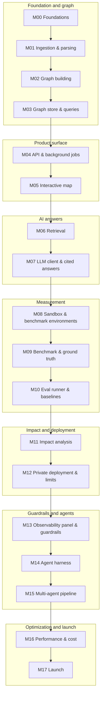

# RepoAtlas milestones

RepoAtlas is built in **18 milestones**, M00 to M17, in strict order. Each milestone is one type of work with 6–12 commit-sized tasks and a test-based exit gate. What to build is defined in [`docs/PRD.md`](../PRD.md); this folder says in what order, with which contracts, and how to know each piece is done.

## Rules

1. **Dependencies only point backward.** Milestone N may depend only on milestones with lower numbers. A milestone file never mentions a later milestone — not in its dependencies, its contracts, or its prose. Later milestones may extend earlier code; earlier milestones never wait on later ones.
2. **Contracts are explicit.** Each milestone lists what it **Provides** (APIs, schemas, CLIs, components). A later milestone may use only contracts that an earlier milestone provides.
3. **Gates are real.** A milestone starts only after the previous milestone's exit criteria all pass. The gate is recorded in the milestone's Results section and tagged `mNN-done`.
4. **Size by work, not time.** S has up to 5 tasks, M has 6–8, L has 9–12. Nothing is XL; an XL milestone gets split.
5. **Requirements have one owner.** Every PRD requirement ID belongs to exactly one milestone (its prefix names the owner). The milestone's Requirements section lists all of them.

`python scripts/check_milestones.py` checks rules 1, 2's table, 4's sections, and 5.

## The chain



The arrows show build order. The exact dependencies of each milestone are in the table below and in each file's "Depends on" section.

## Milestones

| Milestone | Name | Type of work | Size | Depends on | Status |
|---|---|---|---|---|---|
| M00 | [Foundations](M00-foundations.md) | Setup and infrastructure | M | — | Done |
| M01 | [Ingestion & parsing](M01-ingestion-parsing.md) | Static analysis | L | M00 | Done |
| M02 | [Graph building](M02-graph-building.md) | Static analysis | L | M01 | Done |
| M03 | [Graph store & queries](M03-graph-store.md) | Data and persistence | M | M00, M01, M02 | Done |
| M04 | [API & background jobs](M04-api-jobs.md) | Backend service | M | M00, M01, M03 | Done |
| M05 | [Interactive map](M05-interactive-map.md) | Frontend | L | M04 | Done |
| M06 | [Retrieval](M06-retrieval.md) | Search | L | M00, M03, M04 | Done |
| M07 | [LLM client & cited answers](M07-llm-cited-answers.md) | AI application | L | M03, M04, M05, M06 | Done |
| M08 | [Sandbox & benchmark environments](M08-sandbox-environments.md) | Test infrastructure | L | M00, M01 | Done |
| M09 | [Benchmark & ground truth](M09-benchmark-ground-truth.md) | Measurement dataset | M | M01, M08 | Done |
| M10 | [Eval runner & baselines](M10-eval-runner.md) | Measurement | L | M02, M03, M06, M07, M08, M09 | Done |
| M11 | [Impact analysis](M11-impact-analysis.md) | Graph algorithms and feature | L | M03, M04, M05, M07, M10 | Done |
| M12 | [Private deployment & limits](M12-private-deployment.md) | DevOps | M | M00–M11 | Done |
| M13 | [Observability panel & guardrails](M13-observability-guardrails.md) | Reliability and security | L | M04, M05, M07, M10, M11 | Not started |
| M14 | [Agent harness](M14-agent-harness.md) | AI agent | L | M03, M06, M07, M10, M11, M13 | Not started |
| M15 | [Multi-agent pipeline](M15-multi-agent.md) | AI agents | M | M10, M13, M14 | Not started |
| M16 | [Performance & cost](M16-performance-cost.md) | Optimization | M | M02, M03, M04, M05, M06, M10, M13, M15 | Not started |
| M17 | [Launch](M17-launch.md) | Release and content | M | M00–M16 | Not started |

**Minimum-shippable line: after M12.** M12's gate was reached on a self-hosted stack; the hosted private deployment and live checks are pending in [`docs/live-pass.md`](../live-pass.md) (decision 0020). At that point the product works end to end on a private deployment: graph, map, cited answers, benchmark, and impact analysis validated against real test failures. M13–M17 add guardrail gates, agents, cost work, and the public launch. The launch post comes only after M17.

## Working agreement

1. **Start of every session:** read [`CLAUDE.md`](../../CLAUDE.md), then this status table, then the current milestone file.
2. **Task by task:** tick the task's checkbox when its commit lands. One commit per task, using conventional commits (`feat:`, `fix:`, `test:`, `docs:`, `chore:`).
3. **Branches and tags:** one branch per milestone (`mNN-short-name`), merged when the gate passes, tagged `mNN-done`.
4. **Gate:** all exit criteria checked, Results section filled in, status table updated.
5. **Changing an earlier contract:** write a decision record in `docs/decisions/`, update that milestone's Provides section, and fix every dependent. Never silently change a contract.
6. **New ideas:** add them to [`docs/backlog.md`](../backlog.md), not to the current milestone.
7. **Tests:** no live LLM calls in unit tests. Live suites (evaluation, injection) run manually with a cost cap and their results are recorded.
8. **Safety:** repo code runs only in the sandbox; repo content is always untrusted data.

## Definition of done

**A task is done when:**
- the code and its tests are committed together;
- `uv run poe check` (and the frontend checks, once the frontend exists) passes;
- any contract it changes is reflected in the milestone file.

**A milestone is done when:**
- every task is checked;
- every exit criterion is checked, with evidence (command output, report path, or screenshot) noted in Results;
- `python scripts/check_milestones.py` passes;
- the status table says Done and the `mNN-done` tag exists.

## Milestone file template

```
# MNN — Name

**Type of work:** … · **Size:** S | M | L (n tasks) · **Status:** Not started | In progress | Done

## Goal
## Depends on        earlier milestones only, naming the exact contracts used
## Provides          contracts later work may rely on, described generically
## Requirements      PRD IDs this milestone owns
## Scope             In / Out
## Design notes      data model changes, algorithms, prompts, edge cases
## Tasks             ordered checklist; each task = one commit with tests
## Exit criteria     all must pass before the next milestone starts
## Verification      commands and manual checks
## Risks and open questions
## Results           filled in at the gate
```
