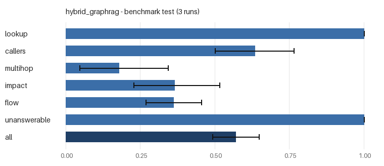

# Results

How accurate RepoAtlas is, measured on its own benchmark, including where it loses.

> **Status of this page.** Every number below was **measured** on the frozen test split on
> 2026-11-12 and 2026-11-13, with live model calls, and can be traced to a report file in
> [`eval/reports/`](../eval/reports/). Some things are **not measured yet** and are listed
> under [Pending](#pending-not-measured-yet) instead of estimated. A test
> (`backend/tests/unit/test_results_page.py`) fails when a number here differs from its
> report.

## What was measured

- **Benchmark 1.0.0:** 130 questions over five public repositories at pinned commits (click,
  requests, httpx, remeda, zod), six question types. 40 questions are the dev split, used for
  tuning; **90 are the test split, frozen** (sha256 `163c2957…dd4cd08`) and used only for the
  numbers on this page. How the questions and their ground truth were made:
  [`eval/benchmark/README.md`](../eval/benchmark/README.md).
- **Ground truth does not come from a model.** Callers, multi-hop, and static impact answers
  come from SCIP indexes built by the compilers' own tooling. Real impact answers come from
  breaking a function in a sandbox and recording which tests fail.
- **Three runs per question.** A score is the question type's primary metric, averaged per
  question over its runs, then over questions, with a 95% bootstrap interval. Differences
  between systems are paired per question (10,000 resamples). Method:
  [decision 0013](decisions/0013-evaluation-methodology.md).
- **Models:** Claude Sonnet 5.5 for answers, for the claim checker, and for the flow judge.
  Embeddings: jina-embeddings-v2-base-code, run locally.

The four answer systems differ only in what evidence the model is given:

| System | Evidence |
|---|---|
| `closed_book` | None. The model answers from memory, given only the repository and commit |
| `bm25_only` | Keyword search over code chunks |
| `vector_only` | Embedding search over code chunks |
| `hybrid_graphrag` | Keyword and embedding search fused, then expanded along the code graph. This is the product's one-shot answering mode as of 2026-11-12 |

## Main comparison: does the graph help?

Test split, 90 questions, 3 runs each. Reports: `eval/reports/2026-11-12-<system>-test.md`.

| Type (metric) | Questions | closed_book | bm25_only | vector_only | hybrid_graphrag |
|---|---|---|---|---|---|
| lookup (correct) | 20 | 0.417 | 1.000 | 1.000 | 1.000 |
| callers (F1) | 20 | 0.158 | 0.220 | 0.541 | 0.635 |
| multihop (F1) | 15 | 0.000 | 0.171 | 0.169 | 0.178 |
| impact (static F1) | 15 | 0.050 | 0.199 | 0.220 | 0.366 |
| flow (must-cite recall) | 15 | 0.170 | 0.316 | 0.357 | 0.361 |
| unanswerable (correct refusal) | 5 | 1.000 | 1.000 | 1.000 | 1.000 |
| **all** | 90 | 0.220 [0.150, 0.296] | 0.441 [0.356, 0.528] | 0.522 [0.439, 0.608] | 0.570 [0.492, 0.648] |
| cost per question | | $0.0036 | $0.0197 | $0.0162 | $0.0220 |
| latency p50 / p95 | | 2.8 s / 6.3 s | 3.5 s / 8.7 s | 4.2 s / 8.9 s | 4.3 s / 8.9 s |



**Hybrid GraphRAG against vector-only search**, paired per question
([report](../eval/reports/2026-11-12-compare-hybrid_graphrag-vs-vector_only-test.md)).
`*` marks an interval that excludes zero.

| Type | Questions | vector_only | hybrid_graphrag | Difference [95% CI] |
|---|---|---|---|---|
| lookup | 20 | 1.000 | 1.000 | +0.000 [+0.000, +0.000] |
| callers | 20 | 0.541 | 0.635 | +0.094 [+0.002, +0.219] * |
| multihop | 15 | 0.169 | 0.178 | +0.009 [-0.025, +0.047] |
| impact | 15 | 0.220 | 0.366 | +0.146 [+0.000, +0.306] * |
| flow | 15 | 0.357 | 0.361 | +0.004 [-0.075, +0.083] |
| unanswerable | 5 | 1.000 | 1.000 | +0.000 [+0.000, +0.000] |
| **all** | 90 | 0.522 | 0.570 | +0.047 [+0.010, +0.090] * |

In words: the graph adds about five points overall, and the gain is real but small. It comes
from two question types, "who calls this?" and "what does changing this affect?", which are
the questions a call graph is for. Against keyword search the overall gain is
+0.129 [+0.072, +0.190]; against no evidence at all, +0.350 [+0.271, +0.430].

## Impact analysis against real test failures

"What breaks if I change X?" is answered by a graph traversal, not by a model, so it is
deterministic and costs $0. Test split, 15 impact questions; 9 of them have real failures
recorded in the sandbox
([report](../eval/reports/2026-11-13-impact_engine-intervals-test.md)).

| Ground truth | Metric | Questions | Mean [95% CI] |
|---|---|---|---|
| Static (SCIP) | precision | 15 | 0.612 [0.386, 0.837] |
| Static (SCIP) | recall | 15 | 0.533 [0.326, 0.741] |
| Static (SCIP) | F1 | 15 | 0.486 [0.289, 0.682] |
| Real (sandbox failures), test level | precision | 9 | 0.333 [0.000, 0.667] |
| Real (sandbox failures), test level | recall | 9 | 0.167 [0.000, 0.389] |
| Real (sandbox failures), test level | F1 | 9 | 0.186 [0.000, 0.444] |

Against the hybrid answer system on the same 15 questions
([report](../eval/reports/2026-11-13-compare-impact_engine-vs-hybrid_graphrag-test.md)):
static F1 0.486 for the engine and 0.366 for hybrid answers, a difference of
0.120 [-0.117, +0.355] in the engine's favour. With 15 questions that interval includes zero,
so it is not a measured win.

## Where RepoAtlas loses

- **Multi-hop questions are not solved.** Every system scores below 0.18 F1 on "which tests
  reach X through an intermediate?", and the graph adds +0.009 [-0.025, +0.047] over vector
  search: nothing. One-shot retrieval finds the target and its direct callers, not
  callers of callers.
- **Flow questions get no help from the graph:** +0.004 [-0.075, +0.083] over vector search.
- **Real test failures are mostly missed.** The impact engine's recall against tests that
  really fail is 0.167 [0.000, 0.389]. Of 704 confirmed failing tests it ranks 30 and misses
  673 ([report](../eval/reports/2026-11-13-impact_engine-unknown-test.md)). Two causes account
  for nearly all of it: click's tests reach their targets through untyped pytest fixtures
  (645 of its 647 failures are invisible to a static graph), and remeda passes
  implementations as values, which leaves no call edge to follow.
- **On real failures, plain answers beat the graph engine:** hybrid answers reach real-failure
  recall 0.306 against the engine's 0.167, because they find tests by their text.
- **Answerable questions get refused.** The hybrid system refused 28 of 255 answerable
  question runs for lack of evidence (vector-only 34, keyword-only 60).
- **The intervals are wide.** With 15 or 20 questions per type, only large differences are
  detectable. The per-type gains for callers and impact have lower bounds of +0.002 and
  +0.000.

## Known biases

- **The judge and the claim checker are the same model family as the answering model.** They
  affect only two secondary numbers (claim support, and the flow judge's score); every primary
  metric above is computed against SCIP or sandbox ground truth without a model.
- **The reference labels used to check the judge were made by Claude, not by a person,** at
  the owner's request. Agreement numbers ([`eval/labels/`](../eval/labels/)) are therefore
  exploratory, and so are the claim-support rates (88% to 91% of checked claims supported).
- **The repositories are popular, and the model has seen them.** `closed_book` answers 42% of
  lookups from memory alone. That is why the evidence systems are scored on what they cite.
- **Five repositories, two languages.** Nothing here says how RepoAtlas does on a large
  monorepo, on JavaScript without types, or on code the model has never seen.
- **One benchmark, written for this project.** The questions were generated from the same
  kinds of structure the graph models. A benchmark built by someone else could rank the
  systems differently.

## Cost

Measured spend of the test-split runs above: closed book $1.12, keyword $6.76, vector $6.17,
hybrid $7.83, for 270 answers each including the checker and judge calls. The system's own
cost per question is in the main table (hybrid: $0.0220). Impact analysis costs $0.
Per-type costs and latencies: [cost baseline](../eval/reports/2026-11-15-cost-baseline.md).

## Pending (not measured yet)

The project was built under a rule of no further API spending
([decision 0020](decisions/0020-build-without-spend-live-pass.md)), so everything added after
2026-11-13 is built and tested without a live model and has **no accuracy or cost numbers**.
These are tracked in [`docs/live-pass.md`](live-pass.md) and will be added here when run.

| Not measured | Why it matters | Live-pass item |
|---|---|---|
| One-shot answers on the current prompt | The prompt was hardened against injected instructions after these runs; the numbers above are for the earlier prompt | 13 |
| Agent mode (the model explores with tools) | Built to address the multi-hop loss above; whether it does is unknown | 13 |
| Multi-agent mode (plan, explore, write, verify) | Same; also its cost per stage | 17 |
| Cost per question for agent and multi-agent modes | Only the one-shot cost above is measured | 20 |
| What prompt caching and cheaper settings save | Estimated by arithmetic only | 21 to 23 |
| Injection resistance against a live model | The detector and prompt layout are tested without a model; canary leaks need live runs | 6, 7, 12, 16 |
| The final evaluation of every system at its final settings | The test split will be used once more, for all systems together | 25 |

## Reproducing

Each report records the benchmark digest, the configuration fingerprint, the model IDs, the
snapshot commits, and the RepoAtlas commit. With an API key and the benchmark snapshots built:

```bash
cd backend
uv run repoatlas eval run --system hybrid_graphrag --split test --runs 3 --max-cost 10.00
uv run repoatlas eval compare <vector report>.json <hybrid report>.json
```

These commands call the API and cost money. The five benchmark repositories are also in the
gallery at the benchmark's commits, so the code behind every question can be opened.
